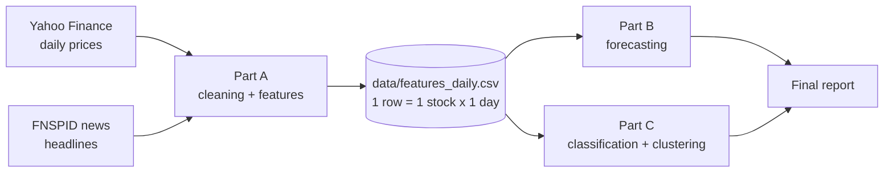

# Part B Guide - Forecasting Next-Week Volatility (RQ1, RQ2)

**Your question:** does adding news to past volatility make the forecast of **next week's volatility**
more accurate? And is the improvement different for **IT** and **Financials** stocks?

You do **not** need to download or clean any data. Part A has done that. You start from one file.

---

## 1. How the data flows



- **20 stocks:** 10 IT (MU, QCOM, ORCL, TXN, ADBE, ACN, FSLR, MRVL, HPQ, WDC) and 10 Financials
  (BX, MS, WFC, V, KKR, USB, ICE, PRU, CME, NDAQ).
- **Period:** 2013-2023, about 55,000 rows.
- Part A will keep improving the file (for example, FinBERT sentiment). **Column names never change**, so
  you just `git pull` and re-run your code.

Full column list: [`PART_A_DATA_GUIDE.md`](PART_A_DATA_GUIDE.md).

---

## 2. The columns you use

| What | Column | Simple meaning |
|---|---|---|
| **Target (what you predict)** | `vol_next5` | How volatile the stock will be over the **next 5 trading days** |
| Past volatility | `gk_vol` | How volatile the stock was **today** |
| | `vol_lag5` | Average volatility over the **last week** |
| | `vol_lag22` | Average volatility over the **last month** (the starter script creates it) |
| | `abs_ret` | Size of today's price move (the starter script creates it) |
| News | `sent_mean` | Average tone of today's headlines (-1 = negative, +1 = positive) |
| | `neg_share`, `pos_share` | Share of today's headlines that are negative / positive |
| | `n_articles`, `no_news` | How many headlines there were / 1 if none |
| Grouping | `sector` | `Information Technology` or `Financials` (for RQ2) |

**HAR-RV** is the standard volatility model in finance. It is simply a **linear regression** of next
week's volatility on today's, last week's and last month's volatility. "HAR-RV with news" just adds the
news columns to the same regression.

---

## 3. How to start (about 10 minutes)

1. Clone the repository (or `git pull` if you already have it) and open `fa582-sentiment-volatility.Rproj` in RStudio.
2. Make your own branch in the Terminal: `git checkout -b <your-name>/part-b`
3. Run the starter script in the Console:
   ```r
   source("partB/partB_starter.R")
   ```
   It takes about 30 seconds and saves its tables in `outputs/part_b/`.
4. Open `outputs/part_b/01_forecast_results.csv` and look at `rmse_change_pct` and `dm_p_value`.

### What the starter script does

For **each model** (HAR-RV, regression tree, Random Forest, boosting) it fits two versions:
**price only** and **price + news**, trained on 2013-2020 and tested on 2022-2023. It then reports:

| Column | Meaning |
|---|---|
| `rmse_price`, `rmse_news` | Forecast error (lower is better) |
| `qlike_price`, `qlike_news` | Volatility-specific error measure (Patton, 2011; lower is better) |
| `rmse_change_pct` | % change in error when news is added. **Negative = news helps** |
| `dm_p_value` | Diebold-Mariano test. **Below 0.05 = the difference is real**, not luck |

**First result** (from the starter, before any tuning): Random Forest improves by 0.9% with news
(p = 0.007), mainly for IT stocks (1.3%, p = 0.014). HAR-RV does not improve. This is a good starting
point to explain and to test further.

---

## 4. Your tasks

| Week | Tasks |
|---|---|
| **1** (Nov 10-17) | Run the starter; understand the results; write a short Part B paragraph for the progress report (Nov 17) |
| **2** (Nov 18-24) | Tune the models on the **2021 validation year** (tree size `cp`, Random Forest `ntree`/`mtry`, boosting `n.trees`/`shrinkage`); add plots (predicted vs. actual volatility over time, by sector); variable importance for Random Forest and boosting |
| **3** (Nov 25-Dec 1) | Re-run with **FinBERT** news columns when Part A adds them (`fb_sent_mean`, `fb_neg_share`, `fb_pos_share`); sector comparison table (RQ2); send your final results table to Part A for the comparison with LSTM |
| **4** (Dec 2-8) | Write the forecasting methods and results sections of the final report; slides for your part |

## 5. Rules (important for a fair test)

- **Never shuffle rows.** Train = up to 2020, validation = 2021, test = 2022-2023. Use the test years **only once**, for the final numbers.
- **Never use `vol_next5` or `high_vol` as an input.**
- Compute any new lag **by ticker** (`by = ticker`).
- Always compare **price only vs. price + news** with the same model and settings.
- Save your tables and figures in `outputs/part_b/`, and push them in your branch.

## 6. Course methods you are using

Linear regression (HAR-RV), regression trees and pruning, bagging/Random Forest, boosting
(Lecture 6), and the train/validation/test approach (Lecture 5).

Questions about the data: ask Dinithi (Part A) or open a GitHub issue.
