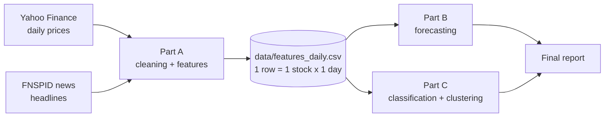

# Part C Guide - Classifying High-Volatility Weeks (RQ3) and Clustering

**Your question:** can news help us **warn in advance** that next week will be a high-volatility week?
You also group trading days into **market regimes** (for example calm vs. stressed) with clustering.

This is the same idea as the **Lecture 5 example** (LDA, QDA and KNN classifying High / Low volatility from
SPY and VIX), but with news features added. You do **not** need to download or clean any data.

---

## 1. How the data flows



- **20 stocks:** 10 IT (MU, QCOM, ORCL, TXN, ADBE, ACN, FSLR, MRVL, HPQ, WDC) and 10 Financials
  (BX, MS, WFC, V, KKR, USB, ICE, PRU, CME, NDAQ).
- **Period:** 2013-2023, about 55,000 rows.
- Part A will keep improving the file (for example, FinBERT sentiment). **Column names never change**, so
  you just `git pull` and re-run your code.

Full column list: [`PART_A_DATA_GUIDE.md`](PART_A_DATA_GUIDE.md).

---

## 2. The columns you use

| What | Column | Simple meaning |
|---|---|---|
| **Target (class)** | `high_vol` | **1 = High** week: next week's volatility is in the top 20% of that stock's 2013-2020 history. **0 = Low** |
| Past volatility | `gk_vol`, `vol_lag5` | Volatility today / average over the last week |
| | `vol_lag22` | Average over the last month (the starter script creates it) |
| | `log_vol`, `log_vol5`, `log_vol22` | Log of the above (the starter creates them). Volatility has heavy tails, so logs suit LDA/QDA better, as in Lecture 5 |
| | `abs_ret` | Size of today's price move |
| News | `sent_mean` | Average tone of today's headlines (-1 to +1) |
| | `neg_share`, `pos_share` | Share of negative / positive headlines |
| | `n_articles`, `no_news` | Number of headlines / 1 if none |
| Grouping | `sector` | `Information Technology` or `Financials` |

High weeks are 20% of the training years but **44% of the test years** (2022-2023 were more volatile),
so plain accuracy can be misleading. Look at **sensitivity** (share of High weeks caught) too.

---

## 3. How to start (about 10 minutes)

1. Clone the repository (or `git pull`) and open `fa582-sentiment-volatility.Rproj` in RStudio.
2. Make your own branch in the Terminal: `git checkout -b <your-name>/part-c`
3. Run the starter script in the Console:
   ```r
   source("partC/partC_starter.R")
   ```
   It takes about 15 seconds and saves its results in `outputs/part_c/`.

### What the starter script does

**Classification.** Logistic regression, LDA, QDA, KNN and a classification tree, each fitted twice:
**price only** and **price + news**. It trains on 2013-2020, tunes **k** (KNN) and the probability
**threshold** on 2021, and tests on 2022-2023. Results in `01_classification_results.csv`:

| Column | Meaning |
|---|---|
| `accuracy` | Share of weeks classified correctly |
| `sensitivity` | Share of **High** weeks that were caught (most important for risk managers) |
| `specificity` | Share of **Low** weeks correctly labeled Low |
| `brier` | Error of the predicted probabilities (lower is better), as in the Lecture 5 code |
| `threshold` | Probability cut-off chosen on 2021 |

**Clustering.** One row per sector per day (average volatility, return, tone, negative share, number of
articles), standardized, then PCA, **k-means with 3 clusters**, and **hierarchical clustering**.
Results in `02_kmeans_regimes.csv` and `03_hierarchical_dendrogram.png`.

**First results** (from the starter, before any tuning):
- Logistic regression: 61.4% accuracy with price only vs. 65.1% with news (it catches 78% of High weeks with news, 90% without, but with many more false alarms).
- k-means finds three clear regimes in both sectors: **calm** (low volatility, slightly positive tone),
  **negative news** (tone about -0.12), and **busy, high-volatility** days (most headlines, highest volatility).

---

## 4. Your tasks

| Week | Tasks |
|---|---|
| **1** (Nov 10-17) | Run the starter; understand the results; write a short Part C paragraph for the progress report (Nov 17) |
| **2** (Nov 18-24) | Improve the classifiers: try different feature combinations and k values (like HW3), confusion matrices, **ROC curves**; add bagging/Random Forest/boosting classifiers (Lecture 6); compare by sector |
| **3** (Nov 25-Dec 1) | Clustering: choose the number of clusters (elbow plot), describe each regime, PCA plot coloured by cluster; check whether news helps more in some regimes; re-run with **FinBERT** columns when Part A adds them; send your final results table to Part A for the LSTM comparison |
| **4** (Dec 2-8) | Write the classification and clustering sections of the final report; slides for your part |

## 5. Rules (important for a fair test)

- **Never shuffle rows.** Train = up to 2020, validation = 2021, test = 2022-2023. Choose k, thresholds and
  settings on 2021; use the test years **only once**, for the final numbers.
- **Never use `vol_next5` or `high_vol` as an input.**
- For KNN, **standardize** with the training means and SDs only (the starter does this).
- Always compare **price only vs. price + news** with the same model and settings.
- Save your tables and figures in `outputs/part_c/`, and push them in your branch.

## 6. Course methods you are using

Logistic regression, LDA, QDA, KNN, confusion matrix, sensitivity/specificity, ROC (Lecture 5);
classification trees, bagging, Random Forest, boosting, PCA, k-means and hierarchical clustering (Lecture 6).

Questions about the data: ask Dinithi (Part A) or open a GitHub issue.
